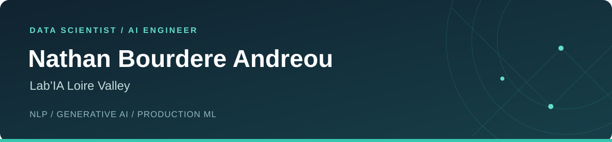

**NLP · Generative AI · Production ML**

[LinkedIn](https://www.linkedin.com/in/nathan-bourdere-andreou/) &nbsp; · &nbsp; [Email](mailto:bourdereandreounathan@gmail.com) &nbsp; · &nbsp; [Repositories](https://github.com/NathanBourdere?tab=repositories)

## About

I'm Nathan, a **Data Scientist at Lab’IA Loire Valley**, with a background in software engineering and natural language processing.

Since **October 2026**, I help organizations understand and adopt AI through awareness sessions, general and technical training, and end-to-end AI projects — through to custom deployment in the client's environment.

My technical background spans model development, data pipelines and deployment: fine-tuning language models, building retrieval-augmented and multi-agent applications, and bringing ML systems into production.

## From models to production

- **La Poste DT — NLP at national scale.** Fine-tuned CamemBERT for municipality and postal-code extraction (BIO-format NER), achieving **0.9725 macro F1** with curriculum learning and hard negative mining. The optimized inference pipeline is deployed nationwide on **Triton Inference Server with Helm**.
- **Malakoff Humanis — Production software.** Developed an internal **ASP.NET Core / TypeScript** application, now in production, to manage a GDPR-compliant data-cleaning campaign.
- **ErgoSanté — Fullstack development.** Built an intranet with **Flask, Vue.js and MariaDB**, integrating Active Directory data through LDAP.

## Toolbox

| Area | Technologies & methods |
| :--- | :--- |
| **NLP & deep learning** | Python, PyTorch, Transformers, spaCy, scikit-learn · NER, fine-tuning, LoRA, quantization |
| **Generative AI** | LangGraph, LangChain, RAG, multi-agent systems, Pydantic |
| **Serving & MLOps** | Triton Inference Server, Helm, Docker, Podman, MLflow |
| **Data & cloud** | Spark, Google Cloud Platform, Databricks, Pandas |
| **Storage & retrieval** | Qdrant, Neo4j, Elasticsearch, MySQL / MariaDB, Oracle, SQLite |
| **Software engineering** | FastAPI, Flask, Django, ASP.NET Core, Vue.js, TypeScript · Java, C#, C / C++, Dart / Flutter |
| **Daily tools** | GitHub / GitLab, Linux / Windows, Bash / PowerShell, VS Code, Visual Studio, Copilot, Claude Code |

## Selected projects

### [NexusMind](https://github.com/NathanBourdere/NexusMind)
**Multi-agent AI · RAG · Gaming**  
A personal project in early development for strategic coaching in League of Legends. Built around LangGraph orchestration, a Scout agent for ETL / scraping, Pydantic schemas and Qdrant-backed retrieval.

### [PageRank2025](https://github.com/NathanBourdere/PageRank2025)
**Distributed data processing · Spark · GCP**  
An academic pipeline for Wikidata graph analysis and Wikipedia page centrality, with Spark / MapReduce and Bash automation for cluster provisioning, configuration and teardown.

### [TinyLDF](https://github.com/NathanBourdere/TinyLDF)
**Knowledge graphs · Linked Data · Cloud**  
An academic Linked Data Fragments server project supporting quadruple-pattern queries, designed for deployment on Google Cloud App Engine.

---

Open to conversations about NLP, generative AI and putting models into production. 
<a href="https://www.linkedin.com/in/nathan-bourdere-andreou/">Let's connect on LinkedIn</a>

